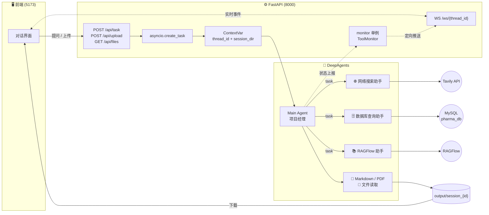
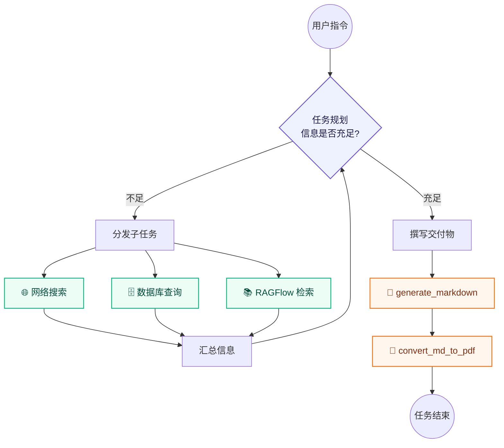
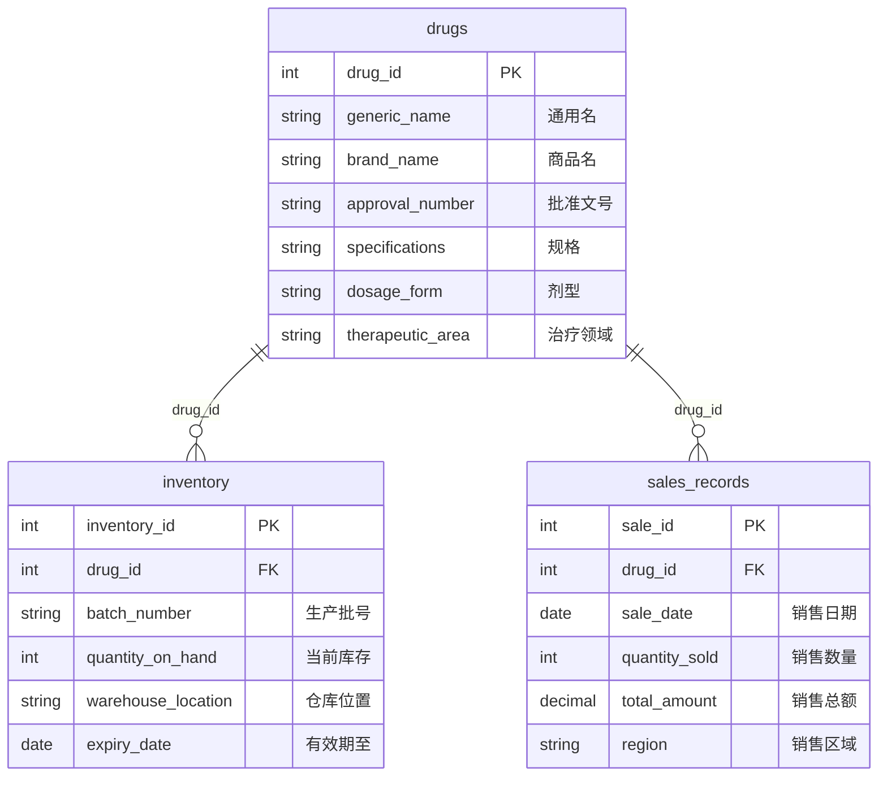
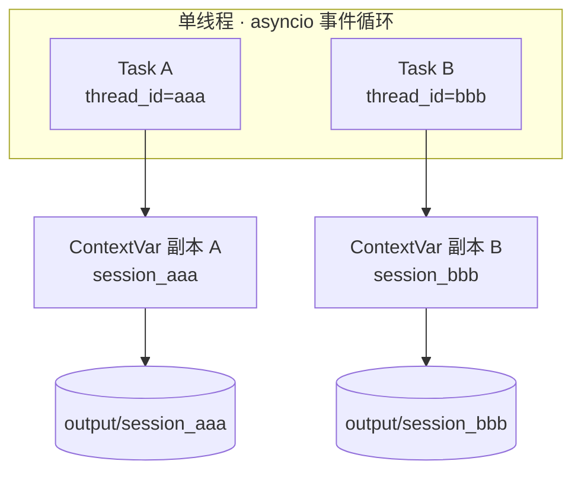
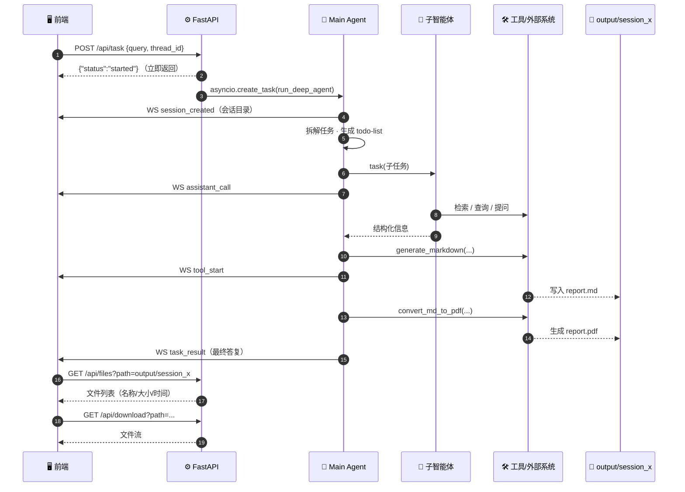

<div align="center">

# 🔎 Deep Search · 深度搜索研究员

**基于 DeepAgents 的「1 主 + 3 专」多路组合智能体系统**

[](https://www.python.org/)
[](https://github.com/langchain-ai/deepagents)
[](https://fastapi.tiangolo.com/)
[](https://fastapi.tiangolo.com/advanced/websockets/)
[](https://www.mysql.com/)
[](#-声明)

<br/>

> 🧠 **搜索 → 阅读 → 反思 → 再搜索**
>
> 用「主智能体统筹 + 多专家子智能体并行协作」，突破传统 RAG 单次检索的天花板，
> 深度挖掘信息背后的隐藏逻辑，输出**广覆盖、高精准、强可靠**的研究报告。

<br/>

[项目简介](#一项目简介) ·
[系统架构](#二系统架构) ·
[快速开始](#五快速开始) ·
[接口文档](#六接口文档) ·
[示例提问](#九示例提问)

</div>

---

## 📑 目录

| 章节 | 内容 | 章节 | 内容 |
| :--- | :--- | :--- | :--- |
| **一** | [项目简介](#一项目简介) | **七** | [工具体系](#七工具体系) |
| **二** | [系统架构](#二系统架构) | **八** | [核心机制](#八核心机制) |
| **三** | [技术栈](#三技术栈) | **九** | [示例提问](#九示例提问) |
| **四** | [目录结构](#四目录结构) | **十** | [常见问题 FAQ](#十常见问题-faq) |
| **五** | [快速开始](#五快速开始) | **十一** | [已知问题 & Roadmap](#十一已知问题--roadmap) |
| **六** | [接口文档](#六接口文档) | **十二** | [开发里程碑](#十二开发里程碑) |

---

## 一、项目简介

本项目是 **DeepAgents 框架**的一次完整工程化实践，目标是构建一位「**深度搜索研究员**」。

它不是"一次提问、一次检索、一次性回答"的问答机器人，而是一套**模拟人类高级研究员思维**的智能体系统：

- 🧭 **主智能体（Leader）** 像项目经理一样理解需求、拆解任务、调度资源、汇总交付；
- 👥 **三位专家子智能体** 各自握有专属数据入口，**并行**取回不同维度的信息；
- 🔁 通过 **搜索 - 阅读 - 反思 - 再搜索** 的多轮迭代，把零散信息收敛成可交付的文档。

### ✨ 核心能力

| 能力 | 说明 |
| :-- | :-- |
| 🌐 **公开信息广域检索** | 接入 Tavily，多角度、由浅入深递进检索（配置上限 5 次 / 3 个维度） |
| 🗄️ **企业业务数据精查** | 直连 MySQL，走「看表 → 预览 → 写 SQL」三步，拿到精确数字而非"大概" |
| 📚 **私有知识库深挖** | 对接 RAGFlow，先发现助手、再多轮提问，保留原始切片避免信息失真 |
| 📄 **文档交付** | 生成 Markdown，再经 Word COM 引擎转为 PDF |
| 📎 **上传即分析** | 支持 md / txt / docx / pdf / xlsx，自动解析并参与推理 |
| 📡 **过程可观测** | WebSocket 实时推送"正在调用谁、执行什么工具、产出什么结果" |
| 🧩 **会话级隔离** | ContextVar 保证多用户并发不串台，产物各归各的 `session_xxx` 目录 |

### 🎯 设计目标

> 让 Agent 具备"研究"的姿态：**先确认信息边界，再决定调谁**；**信息未齐不落笔，落笔必须成文**。

---

## 二、系统架构

### 2.1 全局架构



### 2.2 角色分工

| 角色 | 定位 | 数据边界 | 关键约束 |
| :-- | :-- | :-- | :-- |
| 🧭 **Main Agent** | 项目经理 | 全局视野 | 只调度、不亲自动手检索；信息未齐不落笔 |
| 🌐 **网络搜索助手** | 外勤调研员 | 互联网公开信息 | 至少 3 个角度，最多 5 次检索 |
| 🗄️ **数据库查询助手** | 数据核算员 | 企业内部结构化数据 | 先 `list_tables` 防臆造表名 |
| 📚 **RAGFlow 助手** | 档案管理员 | 企业内部私有文档 | 先取助手列表，至少 2 轮提问，保留原文 |

> 🔑 **调度优先级**：`数据库查询助手` > `RAGFlow 助手` > `网络搜索助手`
> —— 内部数据优先，公开网络兜底；边界不清时三者全上。

### 2.3 思考循环



---

## 三、技术栈

<table>
<tr><th>分层</th><th>技术</th><th>在项目中的职责</th></tr>
<tr><td rowspan="3"><b>🧠 智能体内核</b></td><td>DeepAgents</td><td>多智能体编排范式：<code>create_deep_agent</code> 组装主智能体与子智能体</td></tr>
<tr><td>LangGraph / LangChain</td><td>有状态循环工作流、Tool Calling、流式 <code>astream</code></td></tr>
<tr><td>langchain-openai</td><td>统一 OpenAI 兼容协议，接入 DeepSeek / Qwen 等模型</td></tr>
<tr><td rowspan="4"><b>🌐 服务层</b></td><td>FastAPI</td><td>REST 接口、文件上传下载、静态产物托管</td></tr>
<tr><td>WebSocket</td><td>把 Agent 的思考过程实时推给前端</td></tr>
<tr><td>Uvicorn</td><td>ASGI 服务器引擎</td></tr>
<tr><td>asyncio</td><td>非阻塞 IO，等待检索/生成时仍可响应其他请求</td></tr>
<tr><td rowspan="2"><b>🔌 外部能力</b></td><td>Tavily Search API</td><td>为 AI 设计的搜索：直接返回清洗后的正文，省 Token</td></tr>
<tr><td>RAGFlow SDK <code>0.24.0</code></td><td>企业级 RAG 引擎，命中文档切片</td></tr>
<tr><td rowspan="3"><b>🗃️ 数据与文件</b></td><td>MySQL Connector</td><td>结构化业务数据查询（Text-to-SQL）</td></tr>
<tr><td>pandas / openpyxl / python-docx / pypdf</td><td>Excel、Word、PDF 内容解析</td></tr>
<tr><td>markdown + pywin32 (Word COM)</td><td>Markdown → HTML → PDF 的转换链路</td></tr>
<tr><td rowspan="2"><b>🧰 基础设施</b></td><td>Pydantic / python-dotenv / PyYAML</td><td>请求模型校验、环境变量与 Prompt 配置</td></tr>
<tr><td>ContextVars / Pathlib / colorlog</td><td>协程级上下文隔离、跨平台路径、彩色日志</td></tr>
</table>

---

## 四、目录结构

```text
deep-search/
├── agent/                          # 🧠 智能体层
│   ├── llm.py                      #   大模型初始化（读 .env）
│   ├── load_prompt.py              #   加载 prompt/prompts.yaml
│   ├── main_agent.py               # ⭐ 主智能体组装 + 流式执行 + 状态上报
│   └── sub_agents/
│       ├── db_sub_agent.py         #   数据库查询助手
│       ├── internet_sub_agent.py   #   网络搜索助手
│       └── rag_sub_agent.py        #   RAGFlow 助手
├── api/                            # 🌐 服务层
│   ├── server.py                   # ⭐ FastAPI 入口：任务 / 上传 / 下载 / 文件列表 / WS
│   ├── context.py                  # ⭐ ContextVars 会话隔离
│   └── monitor.py                  # ⭐ 单例监控 + WebSocket 连接管理器
├── prompt/
│   └── prompts.yaml                # ⭐ 主/子智能体的全部 Prompt
├── tools/                          # 🛠️ 工具层（Agent 的双手）
│   ├── internet_search_tool.py     #   Tavily 检索
│   ├── mysql_tools.py              #   库表列举 / 数据预览 / 自定义 SQL
│   ├── ragflow_tools.py            #   助手列表 / 提问
│   ├── markdown_tools.py           #   Markdown 生成
│   ├── pdf_tools.py                #   Markdown → PDF
│   └── upload_file_read_tool.py    #   上传文件解析
├── utils/                          # 🧰 通用工具
│   ├── path_utils.py               # ⭐ 路径清洗与重定向（防串台核心）
│   ├── logger_utils.py             #   彩色日志
│   └── converter_utils.py          #   MD→PDF 转换内核
├── sql/db.sql                      # 🗃️ 医药业务库建表 + 模拟数据
├── output/                         #   运行期产物：output/session_{thread_id}/
├── upload/                         #   上传文件：upload/session_{thread_id}/
├── .env                            # 🔐 环境变量（已被 .gitignore 忽略）
├── pyproject.toml                  #   依赖声明（uv 管理）
└── uv.lock
```

---

## 五、快速开始

### 5.1 前置要求

| 依赖 | 版本要求 | 校验命令 |
| :-- | :-- | :-- |
| 🐍 Python | `>= 3.12` | `python -V` |
| 📦 uv | 最新版 | `uv --version` |
| 🗄️ MySQL | 8.x（本地或远程） | `mysql -V` |
| 🟢 Node.js（仅前端） | `>= 20.19.0` | `node -v` |

### 5.2 安装依赖

```bash
# 进入项目根目录
cd deep-search

# uv 会自动创建 .venv 并安装全部依赖
uv sync
```

### 5.3 配置环境变量

在项目根目录创建 `.env`（**已被 `.gitignore` 忽略，切勿提交**）：

```ini
# ---------- 大模型 ----------
OPENAI_BASE_URL=https://api.deepseek.com
OPENAI_API_KEY=sk-********************
MODEL=deepseek-flash

# ---------- 联网搜索 ----------
# 免费额度 1000 次/月：https://app.tavily.com/
TAVILY_API_KEY=tvly-dev-********************

# ---------- MySQL ----------
MYSQL_USER=root
MYSQL_PASSWORD=******
MYSQL_DATABASE=pharma_db
MYSQL_HOST=localhost
MYSQL_PORT=3306

# ---------- RAGFlow ----------
RAGFLOW_API_URL=http://your-ragflow-host
RAGFLOW_API_KEY=ragflow-********************

# ---------- LangSmith（可选追踪） ----------
LANGSMITH_TRACING=false
LANGSMITH_PROJECT=deep-search_dev
LANGSMITH_API_KEY=lsv2_pt_********************
```

> ⚠️ **安全提示**：`.env` 内含真实密钥，本仓库已将其排除在版本控制之外。若曾误提交，请立即到各平台**重置密钥**。

### 5.4 初始化数据库

```bash
# 方式一：命令行导入
mysql -u root -p < sql/db.sql

# 方式二：用 Navicat / DataGrip 打开 sql/db.sql 后整体执行
```

执行后会得到 `pharma_db` 库与三张核心表：



### 5.5 启动后端

```bash
# 推荐：直接由 Uvicorn 启动 ASGI 应用
uv run uvicorn api.server:app --host 0.0.0.0 --port 8000

# 或复用 server.py 中的启动函数
uv run python -c "from api.server import start_server; start_server()"
```

启动成功后访问 <http://localhost:8000/docs> 可看到自动生成的 Swagger 接口文档。

### 5.6 启动前端

前端工程独立存放（Vite + React），默认监听 `5173`：

```bash
cd deep-agent_frontend
npm install     # 首次运行
npm run dev
```

### 5.7 启动自检清单

- [ ] MySQL 服务已运行，`pharma_db` 三张表有数据
- [ ] `.env` 四组密钥（LLM / Tavily / MySQL / RAGFlow）均已填写
- [ ] 后端 `:8000` 可访问 `/docs`
- [ ] 前端 `:5173` 能建立 WebSocket 连接（Network 面板可见 101 Switching Protocols）
- [ ] 提问后 `output/session_xxx/` 出现产物文件

---

## 六、接口文档

### 6.1 REST 接口

| 方法 | 路径 | 说明 | 关键参数 |
| :--: | :-- | :-- | :-- |
| `POST` | `/api/task` | 提交任务，立即返回，后台异步执行 | `query`、`thread_id` |
| `POST` | `/api/upload` | 上传一个或多个文件到 `upload/session_{id}` | `files`（multipart）、`thread_id`（form） |
| `GET` | `/api/files` | 列出会话产物（递归、按修改时间倒序） | `path`（必须在 `output/` 下） |
| `GET` | `/api/download` | 下载指定文件 | `path`（必须在 `output/` 下） |
| `WS` | `/ws/{thread_id}` | 实时事件推送 + 心跳保活 | 路径参数 `thread_id` |

**提交任务示例**

```bash
curl -X POST http://localhost:8000/api/task \
  -H "Content-Type: application/json" \
  -d '{"query": "列出公司药品的库存列表，生成Markdown文件报告", "thread_id": "demo-001"}'
```

```json
{ "status": "started", "thread_id": "demo-001" }
```

> 🔐 **越权保护**：`/api/files` 与 `/api/download` 均使用 `Path.is_relative_to(output_dir)` 校验，任何指向 `output/` 之外的路径都会被拒绝。

### 6.2 WebSocket 事件协议

服务端统一推送如下结构的消息：

```json
{
  "type": "monitor_event",
  "event": "tool_start",
  "message": "开始执行工具: internet_search",
  "data": { "tool_name": "internet_search", "args": { "query": "武汉天气" } },
  "timestamp": "2025-10-29T16:24:11.382910"
}
```

| `event` | 触发时机 | `data` 主要字段 | 前端建议用法 |
| :-- | :-- | :-- | :-- |
| `session_created` | 会话工作目录创建完成 | `path` | 初始化右侧文件列表 |
| `assistant_call` | 主智能体把子任务派给某个助手 | `assistant_name`、`args.query` | 显示"正在调用 XX 助手" |
| `tool_start` | 主智能体调用工具 | `tool_name`、`args` | 展示工具卡片与入参 |
| `task_result` | 模型输出最终回答 | `result` | 渲染 Markdown 气泡 |
| `error` | 执行链路抛异常 | —— | 红色错误提示 |
| `pong` | 收到前端心跳 | —— | 维持连接 |

> 💡 **跨线程推送**：`monitor._emit` 会判断当前事件循环是否与 WebSocket 管理器一致——同循环直接 `create_task`，不同线程则走 `asyncio.run_coroutine_threadsafe`，避免"协程跑在错误循环"的经典报错。

---

## 七、工具体系

<table>
<tr><th width="90">归属</th><th width="230">工具</th><th>能力</th><th width="90">装饰</th></tr>
<tr><td rowspan="3"><b>🧭 主智能体</b></td><td><code>generate_markdown</code></td><td>把长文本写入 <code>.md</code> 文件，自动补后缀、自动建目录</td><td>✅ <code>@tool</code></td></tr>
<tr><td><code>convert_md_to_pdf</code></td><td>调用 Word COM 引擎把 Markdown 渲染为 PDF</td><td>✅ <code>@tool</code></td></tr>
<tr><td><code>read_file_content</code></td><td>解析 md/txt/docx/pdf/xlsx；Excel 附带 <code>head()</code> 与 <code>describe()</code></td><td>✅ <code>@tool</code></td></tr>
<tr><td><b>🌐 网络助手</b></td><td><code>internet_search</code></td><td>Tavily 检索，支持 <code>topic</code>=general/news/finance</td><td>⏳ 待补</td></tr>
<tr><td rowspan="3"><b>🗄️ 数据库助手</b></td><td><code>list_sql_tables</code></td><td><code>SHOW TABLES</code>，先对齐真实表名，防臆造</td><td>⏳ 待补</td></tr>
<tr><td><code>get_table_data</code></td><td>读取指定表前 100 行，理解字段格式</td><td>⏳ 待补</td></tr>
<tr><td><code>execute_sql_query</code></td><td>执行模型生成的 SQL，返回字段行 + 数据行</td><td>⏳ 待补</td></tr>
<tr><td rowspan="2"><b>📚 RAGFlow 助手</b></td><td><code>get_assistant_list</code></td><td>列出助手名称、描述与关联知识库</td><td>⏳ 待补</td></tr>
<tr><td><code>create_ask_delete</code></td><td>建临时会话 → 提问 → 取流式结果 → 可删会话</td><td>⏳ 待补</td></tr>
</table>

> 📌 详见 [已知问题 & Roadmap](#十一已知问题--roadmap)：部分工具尚未加 `@tool` 装饰、RAGFlow 助手暂为空工具列表。

### Prompt 工程要点

| 策略 | 目的 | 落点 |
| :-- | :-- | :-- |
| **强制多维视角** | 防止"搜一次就交差" | 网络助手 Prompt：至少 3 角度 / 最多 5 次 |
| **次数硬约束** | 防止死循环烧 Token | 同上 |
| **先看表再写 SQL** | 消除表名幻觉 | 数据库助手 Prompt：Step1 列表 → Step2 预览 → Step3 查询 |
| **保留原始切片** | 避免"传话筒效应" | RAG 助手 Prompt：不做概括，原文透传 |
| **信息未齐不落笔** | 杜绝占位符报告 | 主智能体 Prompt：【关键执行顺序】分两步 |
| **不吐路径** | 前端只认产物面板 | 主智能体 Prompt：只回"已成功创建" |

---

## 八、核心机制

### 8.1 ContextVar：并发会话不串台

> **问题**：FastAPI 里成百上千个请求跑在同一线程的多个协程中，全局变量会被互相覆盖——A 的报告会写进 B 的目录。



```python
from api.context import get_session_context, get_thread_context

# 请求入口：绑定身份
session_token = set_session_context(session_dir_str)
thread_token  = set_thread_context(thread_id)

# 任意深度的工具函数：直接取，无需层层传参
session_dir = get_session_context()   # → output/session_{thread_id}

# finally：归还令牌，防止污染后续请求
reset_session_context(session_token, thread_token)
```

### 8.2 resolve_path：路径治理的"海关"

大模型天生爱编路径（`/workspace/report.md`、`/mnt/data/x.md`），还会把会话名重复拼接。`utils/path_utils.resolve_path` 统一收敛：

| 输入场景 | 原始 `filename` | 处理动作 | 最终落点 |
| :-- | :-- | :-- | :-- |
| 虚拟前缀洗白 | `/workspace/report.md` | 剥离 `/workspace` | `session_dir/report.md` |
| 上传文件特判 | `abc/upload/file.pdf` | 截取 `upload/` 之后，按 CWD 解析 | `<CWD>/upload/file.pdf` |
| 嵌套防护 | `session_123/session_123/x.md` | 检测重复会话名并修正 | `session_dir/x.md` |
| `output/` 前缀 | `output/report.md` | 只取文件名 | `session_dir/report.md` |
| 会话内绝对路径 | `D:/.../session_123/a.md` | 校验在会话内，原样返回 | 同左 |
| 会话外绝对路径 | `D:/OtherDir/a.md` | 校验失败，保留原路径 | `D:/OtherDir/a.md` |
| 普通相对路径 | `sub1/sub2/a.md` | 拼接到会话目录 | `session_dir/sub1/sub2/a.md` |

### 8.3 一次任务的完整时序



---

## 九、示例提问

| # | 提问 | 预期链路 | 产物 |
| :-: | :-- | :-- | :-- |
| 1️⃣ | 查询最重要的 5 条刑法规则，生成 pdf 文件报告 | `RAGFlow 助手` → `generate_markdown` → `convert_md_to_pdf` | `report.pdf` |
| 2️⃣ | 列出公司药品的库存列表，生成 Markdown 文件报告 | `数据库助手`（list → preview → SQL join） → `generate_markdown` | `inventory.md` |
| 3️⃣ | 今天武汉天气怎么样？ | `网络搜索助手`（topic=news） → 直接文字作答 | 无文件 |
| 4️⃣ | 分析各治疗领域销售额占比，并给出补货建议 | `数据库助手`（聚合） + `网络搜索助手`（行业动态） → Markdown | `analysis.md` |
| 5️⃣ | （上传《供应商合同.pdf》）总结关键条款并生成报告 | `read_file_content` → `generate_markdown` | `summary.md` |

---

## 十、常见问题 FAQ

<details>
<summary><b>❓ 启动后端报 <code>ModuleNotFoundError: No module named 'agent'</code></b></summary>

<br/>

必须在**项目根目录**执行启动命令，否则 `agent/`、`api/` 不在 `sys.path` 中。

```bash
cd deep-search
uv run uvicorn api.server:app --port 8000
```
</details>

<details>
<summary><b>❓ 前端一直收不到任何进度消息</b></summary>

<br/>

按顺序排查：

1. `thread_id` 是否前后端一致（`/api/task` 与 `ws://.../ws/{thread_id}` 必须相同）；
2. WebSocket 是否在**任务提交之前**建立连接（否则 `active_connections` 里还没有记录）；
3. 浏览器控制台是否出现 `101` 握手成功；
4. `lifespan` 中 `manager.set_loop(loop)` 是否执行（日志含 `WebSocket Manager bound to loop`）。
</details>

<details>
<summary><b>❓ 生成的 PDF 内容乱码 / 表格错位</b></summary>

<br/>

PDF 走的是 **Word COM + HTML** 渲染链路，对字体与样式敏感：

- HTML 模板中已指定 `Microsoft YaHei`，Windows 环境最稳；
- **Linux / macOS 无 Word COM**，需替换为 `weasyprint` 或 `docx2pdf` 等方案；
- 表格务必使用标准 Markdown 管道语法，转换器才会加上边框样式。
</details>

<details>
<summary><b>❓ 数据库工具连不上 / 报缺少配置项</b></summary>

<br/>

检查 `.env` 中四个变量名是否为**大写** `MYSQL_USER` / `MYSQL_PASSWORD` / `MYSQL_DATABASE` / `MYSQL_PORT`，且与 `mysql_tools.py` 中 `os.getenv` 的键名**大小写完全一致**。远程数据库还需确认安全组放通 3306。
</details>

<details>
<summary><b>❓ Tavily 返回 401 / 额度用尽</b></summary>

<br/>

免费版每月 1000 次请求。请到 <https://app.tavily.com/> 确认 Key 有效并查看用量；建议在 Prompt 中保留"最多 N 次检索"的硬约束。
</details>

<details>
<summary><b>❓ 产物文件互相覆盖 / 找不到自己那份</b></summary>

<br/>

所有产物均隔离在 `output/session_{thread_id}/`。若发现文件出现在别的会话目录，检查工具内部是否**绕过了 `resolve_path`** 直接拼接路径。
</details>

---

## 十一、已知问题 & Roadmap

> 项目主体链路已跑通，以下为学习过程中的遗留优化项（欢迎逐条打勾）。

### 🐞 待修复

- [ ] `tools/mysql_tools.py` 中 `cursor.colume_names` 拼写错误，应为 `cursor.column_names`
- [ ] `get_table_config()` 的缺少项判断逻辑取反了（`if not missing_keys` 才抛错）
- [ ] `MYSQL_PORT` 由 `os.getenv` 返回 `str`，建议 `int()` 转换
- [ ] `agent/llm.py` 中模型名硬编码 `"deepseek-flash"`，建议改读 `os.getenv("MODEL")`
- [ ] `.env` 中 `RAGFLOW_API_URL` 与代码读取键名需统一（`ragflow_tools.py` 已对齐）

### 🚧 待完善

- [ ] `internet_search` / `mysql_tools` / `ragflow_tools` 补 `@tool` 装饰器与类型注解
- [ ] `rag_sub_agent.py` 的 `tools` 目前为空列表，需挂载 RAGFlow 两个工具
- [ ] `utils/converter_utils.py` 尚未实现 `convert_md_to_pdf_via_word`，PDF 转换链路待补齐
- [ ] `main.py` 仍是 PyCharm 模板，可替换为统一启动入口
- [ ] 工具内的 `monitor.report_tool(...)` 上报目前被注释，前端看不到细粒度工具事件
- [ ] SQL 工具缺少只读保护（未拦截 `UPDATE` / `DELETE`）

### 🌱 后续规划

- [ ] 引入 `MemorySaver` + `thread_id`，支持多轮追问与上下文记忆
- [ ] 检索结果去重与置信度打分，减少重复信息进入上下文
- [ ] 报告模板化（封面、目录、图表），提升交付物观感
- [ ] 增加单元测试与端到端冒烟脚本
- [ ] 支持导出 Word / PPT，形成多格式交付矩阵

---

## 十二、开发里程碑

```text
64baf23  ├─ 🏗️  基于 DeepAgents 深度搜索项目框架搭建
c941e26  ├─ 🧠  主智能体 - 子智能体构建成功
7e932f7  ├─ 🗄️  MySQL 调用工具配置
7f4ec6e  ├─ ⚙️  大模型配置、日志配置、加载提示词、RAG 子智能体配置
c979908  ├─ 📚  RAGFlow 工具配置
befb8df  └─ 🎉  主 Agent 及 tools 配置完成，项目结束
```

---

## 📜 声明


>
> - 项目中的企业名称、药品信息、销售数据均为**虚构模拟数据**，与任何真实企业无关；
> - 请勿将 `.env` 中的密钥用于生产环境，也不要提交到公开仓库；
> - 引用第三方服务（Tavily / RAGFlow / DeepSeek 等）时请遵守各自的服务条款与配额限制。

<div align="center">

<br/>

**⭐ 如果这个项目对你有帮助，欢迎点个 Star！**

`搜索不止一次，理解才刚开始。`

</div>
